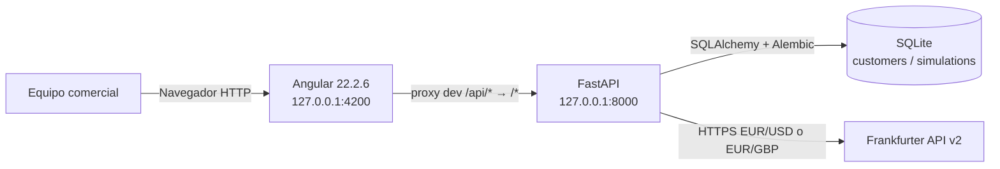
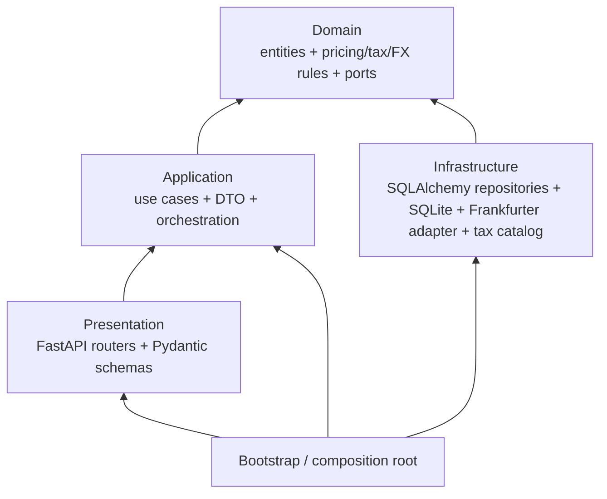
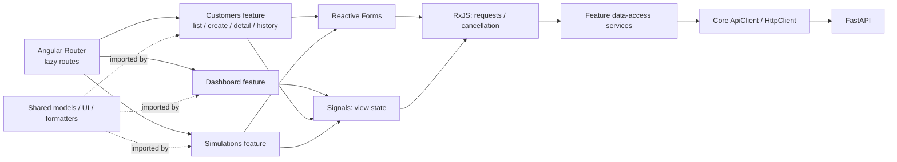
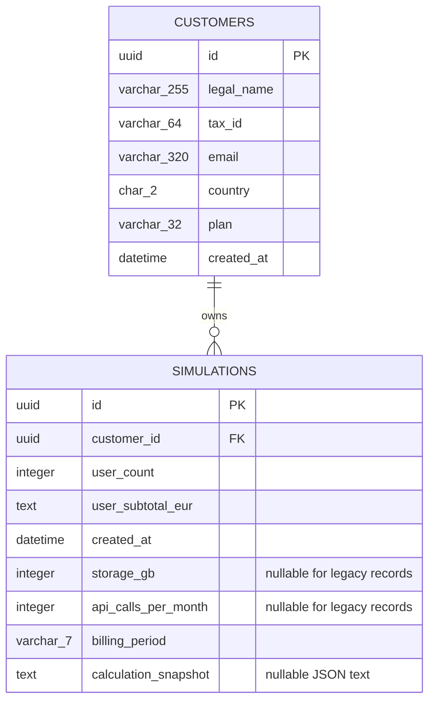
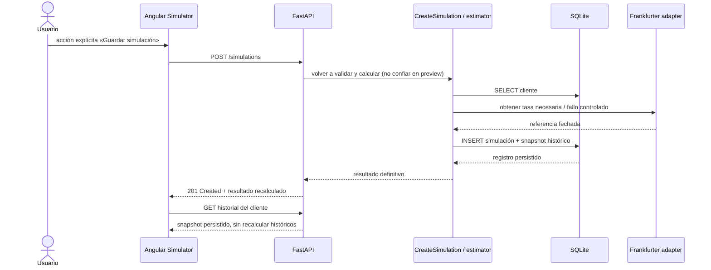

# Arquitectura y modelo de datos

## Alcance y contexto

Monolito modular local: Angular sirve la interfaz; FastAPI expone REST/OpenAPI, calcula y
persiste; SQLite almacena clientes y simulaciones. Las consultas de referencia EUR→USD/GBP
se originan desde el adaptador del backend a Frankfurter. El navegador nunca consulta el
proveedor directamente. EUR identidad no requiere red.



El proxy `/api` solo está configurado para `ng serve`; endpoints reales no llevan prefijo.
No se ha configurado CORS, reverse proxy de producción, autenticación ni despliegue.

## Backend: dependencias entre capas

Estructura real: `backend/src/saas_o_matic/{domain,application,infrastructure,presentation,bootstrap}`.
El composition root (`bootstrap/main.py`) ensambla adaptadores y dependencias. Dominio no
importa FastAPI, Pydantic ni SQLAlchemy; los esquemas HTTP y modelos ORM son distintos.



Las flechas de capas representan imports/dependencias: `infrastructure` implementa puertos
del dominio y no depende de application. Bootstrap es el punto externo de composición.

## Frontend: estructura y flujo de estado

Estructura real bajo `frontend/src/app/`: `core` (configuración, API HTTP, shell/layout),
`features` (dashboard, customers, simulations, not-found) y `shared` (modelos de contrato,
presentación, utilidades y componentes comunes). `app.routes.ts` carga features lazy.



Signals mantienen estado de interfaz; RxJS coordina operaciones asíncronas, cancelación y
respuestas; formularios reactivos validan entradas. No existe un store global. Los DTO
duplican el contrato del OpenAPI tipado; el servidor sigue siendo autoridad del cálculo.

## Modelo persistido (revisiones Alembic 0001–0004)



PK/FK y la unicidad `(country, tax_id)` son relacionales. `user_subtotal_eur` es texto
decimal exacto, no `REAL`. `calculation_snapshot` es columna `TEXT` que contiene JSON
versionado (schema_version `1`): importes/tasas como cadenas, país/tasa/fuente/versión y
ámbito fiscal, currency FX, fechas y fuente. No es una tabla relacional adicional. Datos
históricos incompletos permanecen `NULL`, no se reconstruyen desde catálogos o FX actuales.

## Secuencia de preview

```mermaid
sequenceDiagram
  actor User as Usuario
  participant UI as Angular Simulator
  participant API as FastAPI
  participant App as Preview use case / estimator
  participant DB as SQLite
  participant FX as Frankfurter adapter
  User->>UI: cambia usuarios/consumo/divisa
  UI->>API: POST /simulations/preview
  API->>App: validar, cargar cliente y calcular
  App->>DB: SELECT cliente (sin DML)
  App->>FX: obtener referencia si currency ≠ EUR
  FX-->>App: quote fechada / error controlado
  App-->>API: preview autoritativa
  API-->>UI: 200; no id de persistencia
  UI-->>User: total y metadatos visibles
  Note over DB: Preview no ejecuta INSERT/UPDATE/DELETE
```

## Secuencia de guardado



La tasa puede variar entre preview y guardado. La respuesta `201` es el resultado definitivo;
el historial conserva el cálculo original, no depende de tasas actuales.

## Secuencia de error FX

```mermaid
sequenceDiagram
  actor User as Usuario
  participant UI as Angular
  participant API as FastAPI
  participant FX as Frankfurter adapter
  User->>UI: solicita preview USD/GBP
  UI->>API: POST /simulations/preview
  API->>FX: consulta EUR→destino (timeout 5 s)
  FX--xAPI: error HTTP/red/JSON/tasa inválida
  API-->>UI: 503 application/problem+json
  UI-->>User: estado de error; no presenta tasa ficticia ni permite guardar preview stale
  User->>UI: reintenta o selecciona EUR
  UI->>API: nueva preview
  Note over API,FX: EUR usa tasa identidad y no requiere proveedor
```

## Organización resumida del repositorio

```text
backend/src/saas_o_matic/
  domain/ application/ infrastructure/ presentation/ bootstrap/
backend/migrations/versions/    # 0001–0004
backend/tests/                  # pytest, incluyendo migraciones/API
frontend/src/app/core/          # shell, HTTP y configuración
frontend/src/app/features/      # dashboard, clientes, simulaciones
frontend/src/app/shared/        # modelos y presentación reutilizable
frontend/e2e/                   # Playwright / axe
docs/                           # requisitos, SPEC, ADR y guías
ai-workspace/                   # trazabilidad, tareas y auditorías
```

La modularidad permite probar el dominio sin HTTP/SQLite, usar puertos para FX/repositorios,
y mantener la política económica en backend. El proyecto no se reorganiza ni se separa en
servicios desplegables.
